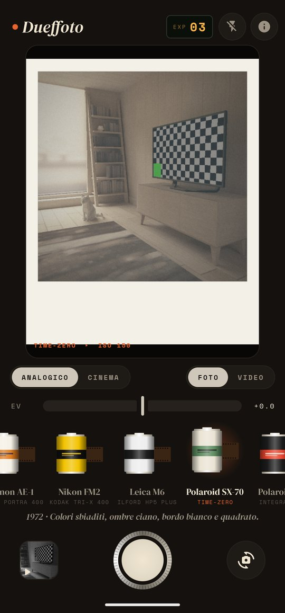
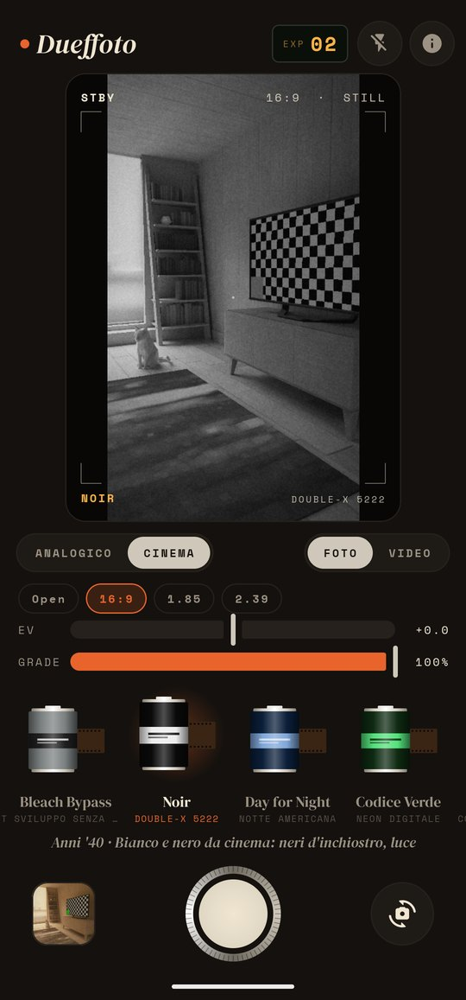

# Dueffoto

**Fotocamere che non esistono più, nel tuo telefono.**

Foto e video nello stile delle vecchie fotocamere a pellicola, oppure con un look da cinema moderno.

  
  
  
  
  

## Cosa fa

- **19 fotocamere analogiche**, ognuna con la sua pellicola: Olympus Trip 35 con Kodak Gold, Canon AE-1 con Portra 400, Nikon FM2 con Tri-X, Leica M6 con HP5, Polaroid SX-70 e 600, Instax Mini, Instamatic, LOMO LC-A, Holga, Yashica T4, Pentax K1000, Contax T2 con CineStill 800T, la usa e getta con la data arancione, Velvia, Ektachrome, una pellicola scaduta, Zenit-E e Kodak Brownie.
- **Modo cinema** con 8 color grading (Golden Hour, Teal & Orange, Moody, Bleach Bypass, Noir, Day for Night, Codice Verde, Pastello), rapporti 16:9, 1.85 e 2.39, dose del grading regolabile e HUD da cinepresa con timecode.
- **Scegli prima o dopo.** Scegli la pellicola e scatti: la stampa va subito in Galleria. Oppure scatti con "Scegli dopo" e decidi in **camera oscura**.
- **Il mirino è già sviluppato**: vedi la pellicola, la grana, la vignettatura e la cornice mentre inquadri.
- **Stampe vere**: bordo bianco delle istantanee, formato quadrato, perforazioni e scritte arancioni del bordo pellicola, data delle compatte anni '90, fughe di luce della Holga.
- **Video** con la stessa pellicola, applicata come LUT 3D a ogni fotogramma.
- **Rullino**: gli originali restano nell'app, puoi svilupparli di nuovo con un'altra pellicola quando vuoi.
- Esposizione, flash, zoom con due dita e messa a fuoco col tocco.
- **Aggiornamenti dall'app**: Dueffoto controlla l'ultima release di questa repository, scarica l'APK e lo installa.

## Installazione

Scarica `Dueffoto-x.y.z.apk` dall'[ultima release](https://github.com/carellice/dueffoto/releases/latest) e aprilo sul telefono (Android 8.0 o successivo). Gli aggiornamenti successivi si installano dall'app: tocca **ⓘ** in alto a destra.

## Come funziona

| File | Contenuto |
|---|---|
| `Film.kt` | Le pellicole e la "chimica" del colore: esposizione, bilanciamento, saturazione, curva, viraggio di ombre e luci, neri slavati |
| `Darkroom.kt` | Lo sviluppo: grana, vignettatura, fughe di luce, cornici, data e la LUT 3D per i video |
| `Camera.kt` | CameraX: fotogrammi del mirino, scatto e registrazione |
| `VideoLab.kt` | Sviluppo dei video con Media3 Transformer |
| `Roll.kt` | Rullino degli originali e salvataggio in Galleria |

Le foto vengono salvate in `Immagini/Dueffoto`, i video in `Film/Dueffoto`.

I nomi delle fotocamere e delle pellicole servono solo a descrivere lo stile imitato: Dueffoto non è collegata ai rispettivi marchi.

## Licenza

MIT — Flavio Ceccarelli
